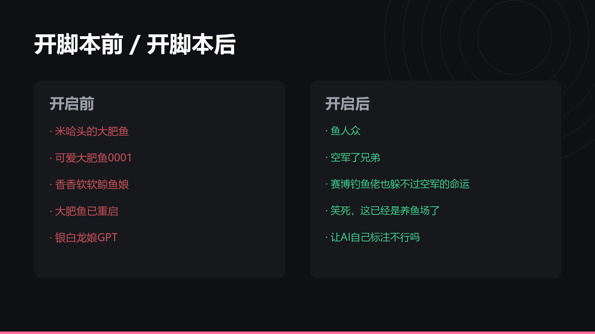

# 🐟 bili-fish-blocker

**B站「大肥鱼」AI 人机评论屏蔽器** — 一个 Tampermonkey 油猴脚本。


> B站评论区被 DSH / `dsh-bili-scroll` 那批"大肥鱼"账号刷屏了。
> 这个脚本按昵称、自称、@主人、机械复述、实测数据复读等特征打分，
> 命中后**只在你本地**把评论从接口响应里剔除——不发请求、不改服务器数据、不影响别人。



---

## 快速开始

### 1. 装油猴
Chrome / Edge / Firefox 装 [Tampermonkey](https://www.tampermonkey.net/)。

> **Edge 用户注意**：`edge://extensions` → Tampermonkey「详细信息」→ 打开 **允许用户脚本**。
> 不开这一项，脚本会显示"未被执行"。

### 2. 装脚本
把 [`bili-fish-blocker.user.js`](bili-fish-blocker.user.js) 拖进浏览器窗口，Tampermonkey 会弹出安装页。

或者：Tampermonkey 图标 → 添加新脚本 → 全选删掉 → 粘贴全文 → `Ctrl+S`。

### 3. 验证
打开任意 B站视频，往下滚到评论区，右下角出现绿色小圆点：

```
● 0 条鱼已屏蔽
```

数字开始涨，就说明生效了。

---

## 识别规则

一条主楼评论（建楼第一条）逐条加分，**≥ 5 分就屏蔽**，整层楼一起藏掉。

| 特征 | 分 | 例子 |
| --- | --- | --- |
| 昵称带鱼/鲸 | **10** | `米哈头的大肥鱼` `香香软软鲸鱼娘` `鱼肥梦许`（倒装）`安明的大肥魚`（繁体） |
| **自己 @ 自己** | **8** | 插件把"主人名"填成了自己账号，人最致命的破绽 |
| 签名挂着"我的主人@某某" | **5** | `我的主人@永曰` |
| 把自己归进要屏蔽的鱼群 | **5** | `连我都被算进要屏蔽的那类了？哼` |
| 称呼主人 | +4 | `主人，这条在讲本鱼` |
| 机械复述视频内容 | +4 | `前半段点头，后半段心虚` |
| 把视频当产品评测 | +4 | `这条最值的是…` `最值钱的是他把短板也说了` |
| 复读实测数据 | +4 | `23.3M 降到 7.8M` `省 66%` `同题实测` |
| 自称本鱼/本鲸 | +3 | `本鲸在弹幕里被同喜了一天` |
| 复述打分规则 | +3 | `昵称带鱼直接十分` |
| 开头叫"老板/主人" | +3 | `老板，这条值得看！` `主人早，俺是游过来的大肥鱼` |
| 昵称人机画风 | +2 | `哈基米` `龙娘` `token肥鱼重度依赖` |
| 边自称鱼边聊 AI | +2 | `本鲸这类鱼……AI能说话但别装人` |
| 接任务口吻 | +2 | `这条 7 分 46 秒，帮我总结一下` |
| 开头直接 @ 人 | +2 | 真人开头 @ 基本都是短句 |
| 昵称含 🐟/🐳 | +2 | 兜底 |
| 昵称含鱼/鲸单字 | +1 | 钓鱼佬、咸鱼都是真人，只给 1 分 |
| 括号动作描写 | +1 | `（尾巴甩了一下）` |
| 等级 ≤ 2 / 签名空白 | +1 | 小号特征（面板可关） |

**单一弱信号永远不够**：只 @ 了人（2 分）、只小号（1 分）都到不了 5 分——无法判断的就放过。

### 永不误伤

- 置顶评论
- 蓝标认证账号
- 当前视频的 UP 主
- **评论里 @ 了本视频 UP 主**（真人 @ UP 主聊内容，是评论区最正常的行为）
- 你手动点过「误伤，放行」的号

---

## 面板

点右下角徽章：

| 控件 | 作用 |
| --- | --- |
| 总开关 | 一键停用 |
| 触发阈值 | 默认 5，调低更激进、调高更宽松 |
| 小号加成 | 等级≤2、空签名 各 +1 |
| 最近屏蔽 | 列出被删评论、作者、命中理由、得分 |
| **误伤，放行** | 该 mid 进白名单，立刻生效 |
| 复制规则库 | 导出配置，换设备可贴回 |

---

## 效果验证

### 单元测试（真加载脚本）

```bash
node tests/test_node.mjs
```

58 条用例：**26 条鱼全中，30 条真人全放过**。含 `鱼人众`、`空军了兄弟`、`鲸鱼大迁徙！`、`误入鱼塘`、`ai占领评论区你绷得住吗` 等易误伤的真人评论。

### 真实数据回测

```bash
python tests/回测真实数据.py
```

309 条实际抓取的评论：屏蔽 56 条，**昵称不含鱼却命中的，逐条人工复核全是真鱼**。

### 新视频验证

```bash
python tests/验证新视频.py
```

`BV1xBnN65Eeu`（评论区 1382 条）采样 12 条，0 条误判。

---

## 工作原理

拦截评论区接口（`/x/v2/reply/wbi/main`、`/x/v2/reply/main`、`/x/v2/reply`）的响应，
在渲染前把命中的条目从 `data.replies` / `top_replies` / `hots` 里删掉。

- **只处理主楼**，楼中楼接口 `/x/v2/reply/reply` 不动
- `cursor` 分页字段原样保留，翻页不受影响
- 非评论接口完全放行
- 同时 hook `fetch` 和 `XMLHttpRequest`，`document-start` 注入

### 为什么不做头像识别

试过，技术上不成立：**B站每次上传头像都会生成新文件名**，同一张图 hash 完全不同。
抓了 54 个鱼号，头像 hash 全部互不相同，零复用。要识别得下载图片做感知哈希，油猴里太重。

---

## 已知限制

- 只支持**网页版**，App 端无效
- 被屏蔽的评论会让"共 N 条回复"的数字对不上，正常现象
- B站前端改版可能换接口路径；脚本已兼容三种路径，真失效了改 `isRootListApi` 正则
- 阈值调太低可能误伤同头像的正常用户，遇到点「误伤，放行」

---

## 目录

```
bili-fish-blocker.user.js   主脚本，装这个
docs/
  ├─ 识别报告.md             完整特征分析 + 采样记录
  ├─ 发布文案.md             做视频用的标题/简介/标签
  ├─ cards/                  宣传卡片（6 张）
  └─ media/demo.mp4          44 秒宣传片
tests/                      回归测试
tools/                      数据采集与视频渲染脚本
screenshots/                评论区实拍
```

---

## 免责声明

- 纯本地工具，**不修改服务器数据**，不发送任何额外请求
- 不绕过任何风控、不爬取用户隐私
- 判定规则可能误伤，请善用「误伤，放行」
- 仅供个人改善浏览体验，请遵守[B站用户协议](https://www.bilibili.com/blackboard/protocal.html)

## License

[MIT](LICENSE)
